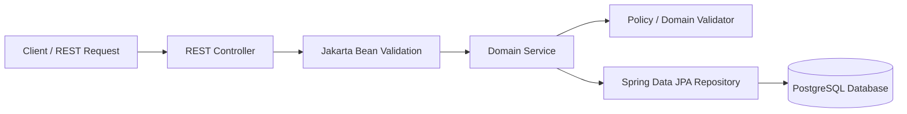

# GroupBuy — System Architecture (Phase 1)

## 1. Architectural Style: Modular Monolith

GroupBuy is architected as a **Modular Monolith**. Rather than introducing premature microservices complexity (network latency, distributed transaction coordination, serialization overhead, operational complexity), GroupBuy structures business capabilities as strongly encapsulated domain modules within a single, highly cohesive codebase.

### Benefits of this Architecture
- **In-process communication & transactional integrity**: Multi-entity workflows (such as inventory reservation and participation creation) can utilize local ACID database transactions.
- **Clear bounded contexts**: Each module maintains explicit boundaries and clear public interfaces.
- **Student & Interview friendly**: Easy to understand, trace in an IDE, run locally with zero cloud dependencies, and reason about state transitions.
- **Future-ready evolution**: Package boundaries mirror potential future microservices. If high traffic later demands splitting, the boundaries are already enforced.

---

## 2. Package Boundaries and Responsibilities

The codebase follows the base package `com.groupbuy` with defined module packages:

```text
com.groupbuy/
├── GroupBuyApplication.java        # Entry point and global UTC initialization
├── common/                         # Shared kernel: constants, exceptions, REST envelopes
│   ├── constants/                  # Monetary scale, currency codes, rounding rules
│   └── exception/                  # Centralized REST error handling & business exceptions
├── config/                         # Infrastructure & cross-cutting configuration
│   ├── SecurityConfig.java         # Stateless Spring Security filter chain
│   ├── CorsProperties.java         # Type-safe CORS property bindings
│   ├── OpenApiConfig.java          # OpenAPI / Swagger UI 3.0 documentation
│   └── JpaConfig.java              # JPA / UTC timezone configuration
├── auth/                           # (Phase 2) User authentication, JWT issuance & tokens
├── user/                           # (Phase 2) User accounts, profiles, seller roles
├── product/                        # (Phase 2) Catalog items, inventory tracking
├── campaign/                       # (Phase 3) Group-buying campaign lifecycle
├── pricing/                        # (Phase 1 Implemented) Dynamic volume-tier pricing engine
│   ├── domain/                     # PricingTier value object & boundary matching
│   ├── dto/                        # PricingQuoteRequest, PricingTierDto, PricingQuoteResponse
│   ├── service/                    # PricingService & PricingPolicyValidator
│   └── controller/                 # REST endpoint POST /api/v1/pricing/quote
├── participation/                  # (Phase 4) Customer reservations & quantity commitments
├── inventory/                      # (Phase 4) Concurrency-safe stock holds
├── payment/                        # (Phase 5) Payment gateway integrations & state machine
├── order/                          # (Phase 6) Order generation and snapshotting
├── audit/                          # (Phase 8) Security & state change audit logs
└── scheduler/                      # (Phase 7) Automated campaign finalization background jobs
```

---

## 3. Controller-Service-Repository Pattern

GroupBuy enforces a strict separation of concerns across tiers:



### 1. Controllers (Thin Layer)
- Strictly responsible for HTTP protocol translation: URL routing, deserialization, HTTP status codes, and input validation triggering (`@Valid`).
- Must **never** execute business logic or construct queries directly.
- Returns DTOs (`PricingQuoteResponse`), never internal JPA persistence entities.

### 2. Services (Rich Business Logic Layer)
- Encapsulates domain invariants, workflows, and transactional boundaries (`@Transactional`).
- Orchestrates domain validators (`PricingPolicyValidator`) and database interactions.
- Performs monetary calculations using `BigDecimal` with explicit scale and rounding mode (`RoundingMode.HALF_EVEN`).

### 3. Repositories (Data Access Layer)
- Spring Data JPA abstractions communicating with PostgreSQL.
- Queries encapsulate database-specific indexes and optimistic locking.

---

## 4. Cross-Cutting Design Principles

1. **Constructor Injection**: All dependencies are injected via constructor, guaranteeing immutability and facilitating fast, mock-free unit testing.
2. **DTO / Entity Isolation**: Persistence entities reflect the database schema; DTOs reflect external API contracts. Decoupling ensures internal database refactoring never breaks external API consumers.
3. **No Float/Double for Currency**: All monetary values are strictly modeled using `BigDecimal` in Java and `NUMERIC(12, 2)` in PostgreSQL.
4. **Universal UTC Timestamps**: Timestamps use `java.time.Instant` / `TIMESTAMPTZ` with JVM timezone forced to UTC at startup.
5. **Centralized Error Handling**: `@RestControllerAdvice` catches both business exceptions (`BusinessException`, `InvalidPricingPolicyException`) and framework validation failures (`MethodArgumentNotValidException`), formatting them into a standard `ErrorResponse` envelope. Internal stack traces, raw SQL queries, and connection strings are masked from clients.
6. **Optimistic Locking**: State-sensitive entities (campaigns, products, reservations) incorporate a `version BIGINT` column to prevent concurrent write anomalies without locking the database.
