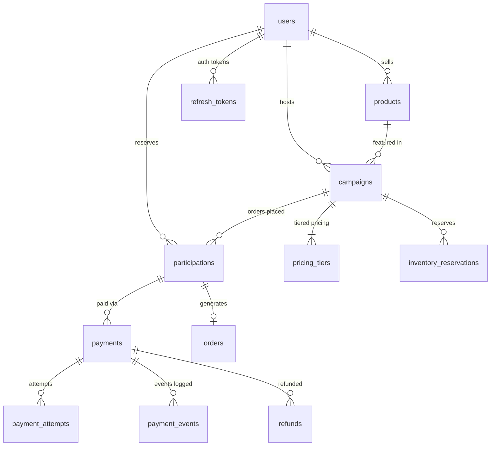

# GroupBuy — Database Design and Schema Specification

## 1. Schema Overview

The GroupBuy schema is built on **PostgreSQL 16** and managed via **Flyway database migrations** (`V1__initial_schema.sql`). The schema is normalized (3NF) to guarantee transactional integrity, data consistency, and deterministic financial accounting.

---

## 2. Core Relational Entities

### 1. `users`
Stores user identities, credentials, and roles.
- `id`: `BIGSERIAL PRIMARY KEY`
- `email`: `VARCHAR(255) NOT NULL UNIQUE`
- `username`: `VARCHAR(100) NOT NULL UNIQUE`
- `password_hash`: `VARCHAR(255) NOT NULL` (Argon2 / BCrypt hash)
- `role`: `VARCHAR(50) NOT NULL CHECK (role IN ('CUSTOMER', 'SELLER', 'ADMIN'))`
- `status`: `VARCHAR(50) NOT NULL CHECK (status IN ('ACTIVE', 'SUSPENDED', 'DELETED'))`
- `version`: `BIGINT NOT NULL DEFAULT 0` (Optimistic concurrency)
- `created_at`, `updated_at`: `TIMESTAMPTZ NOT NULL DEFAULT CURRENT_TIMESTAMP`

### 2. `products`
Catalog items created by sellers.
- `id`: `BIGSERIAL PRIMARY KEY`
- `seller_id`: `BIGINT NOT NULL REFERENCES users(id)`
- `sku`: `VARCHAR(100) NOT NULL UNIQUE`
- `base_price`: `NUMERIC(12, 2) NOT NULL CHECK (base_price > 0)`
- `total_inventory`: `INT NOT NULL CHECK (total_inventory >= 0)`
- `available_inventory`: `INT NOT NULL CHECK (available_inventory >= 0 AND available_inventory <= total_inventory)`
- `version`: `BIGINT NOT NULL DEFAULT 0`

### 3. `campaigns`
Time-limited group-buying events.
- `id`: `BIGSERIAL PRIMARY KEY`
- `product_id`: `BIGINT NOT NULL REFERENCES products(id)`
- `seller_id`: `BIGINT NOT NULL REFERENCES users(id)`
- `target_min_quantity`: `INT NOT NULL CHECK (target_min_quantity > 0)`
- `max_campaign_quantity`: `INT CHECK (max_campaign_quantity IS NULL OR max_campaign_quantity >= target_min_quantity)`
- `current_paid_units`: `INT NOT NULL DEFAULT 0 CHECK (current_paid_units >= 0)`
- `status`: `VARCHAR(50) NOT NULL CHECK (status IN ('DRAFT', 'ACTIVE', 'ENDED', 'FINALIZING', 'FINALIZED', 'CANCELLED'))`
- `starts_at`, `ends_at`: `TIMESTAMPTZ NOT NULL` with `CHECK (ends_at > starts_at)`
- `final_unit_price`: `NUMERIC(12, 2)` (Settled final unit price across all participants)
- `version`: `BIGINT NOT NULL DEFAULT 0`

### 4. `pricing_tiers`
Configurable volume-discount tiers tied to a campaign.
- `id`: `BIGSERIAL PRIMARY KEY`
- `campaign_id`: `BIGINT NOT NULL REFERENCES campaigns(id) ON DELETE CASCADE`
- `min_quantity`: `INT NOT NULL CHECK (min_quantity > 0)`
- `max_quantity`: `INT CHECK (max_quantity IS NULL OR max_quantity >= min_quantity)`
- `unit_price`: `NUMERIC(12, 2) NOT NULL CHECK (unit_price >= 0)`
- `currency`: `VARCHAR(3) NOT NULL DEFAULT 'INR'`
- **Invariants**: Unique index on `(campaign_id, min_quantity)` ensures no duplicate tier starting points.

### 5. `participations`
Customer commitments to purchase units in a campaign.
- `id`: `BIGSERIAL PRIMARY KEY`
- `campaign_id`: `BIGINT NOT NULL REFERENCES campaigns(id)`
- `user_id`: `BIGINT NOT NULL REFERENCES users(id)`
- `quantity`: `INT NOT NULL CHECK (quantity > 0)`
- `authorized_unit_price`: `NUMERIC(12, 2) NOT NULL CHECK (authorized_unit_price >= 0)`
- `authorized_total_amount`: `NUMERIC(12, 2) NOT NULL CHECK (authorized_total_amount >= 0)`
- `final_unit_price`: `NUMERIC(12, 2)` (Set upon campaign finalization)
- `final_total_amount`: `NUMERIC(12, 2)`
- `status`: `VARCHAR(50) NOT NULL CHECK (status IN ('INITIATED', 'AUTHORIZED', 'CONFIRMED', 'CANCELLED', 'REFUNDED'))`
- **Design Note**: A user may participate multiple times in a campaign or have historical cancelled records; hence, no restrictive `UNIQUE (campaign_id, user_id)` constraint is placed.

### 6. `inventory_reservations`
Temporary stock holds while payments are authorized.
- `id`: `BIGSERIAL PRIMARY KEY`
- `campaign_id`: `BIGINT NOT NULL REFERENCES campaigns(id)`
- `product_id`: `BIGINT NOT NULL REFERENCES products(id)`
- `participation_id`: `BIGINT REFERENCES participations(id)`
- `reserved_quantity`: `INT NOT NULL CHECK (reserved_quantity > 0)`
- `status`: `VARCHAR(50) NOT NULL CHECK (status IN ('PENDING', 'COMMITTED', 'RELEASED', 'EXPIRED'))`
- `expires_at`: `TIMESTAMPTZ NOT NULL` (Checked by background cleaner to release expired holds)

### 7. `payments`
Financial transactions managing two-phase authorization and capture.
- `id`: `BIGSERIAL PRIMARY KEY`
- `participation_id`: `BIGINT NOT NULL REFERENCES participations(id)`
- `user_id`: `BIGINT NOT NULL REFERENCES users(id)`
- `authorized_amount`: `NUMERIC(12, 2) NOT NULL CHECK (authorized_amount >= 0)`
- `captured_amount`: `NUMERIC(12, 2) NOT NULL DEFAULT 0 CHECK (captured_amount <= authorized_amount)`
- `refunded_amount`: `NUMERIC(12, 2) NOT NULL DEFAULT 0 CHECK (refunded_amount <= captured_amount)`
- `status`: `VARCHAR(50) NOT NULL CHECK (status IN ('PENDING', 'AUTHORIZED', 'CAPTURED', 'PARTIALLY_REFUNDED', 'REFUNDED', 'FAILED'))`

### 8. `payment_attempts`
Tracks individual gateway communication attempts (retries, timeouts).
- `id`: `BIGSERIAL PRIMARY KEY`
- `payment_id`: `BIGINT NOT NULL REFERENCES payments(id)`
- `attempt_number`: `INT NOT NULL CHECK (attempt_number > 0)`
- `gateway_transaction_id`: `VARCHAR(255)`
- `amount`: `NUMERIC(12, 2) NOT NULL`
- `status`: `VARCHAR(50) NOT NULL CHECK (status IN ('INITIATED', 'SUCCESS', 'FAILURE', 'TIMEOUT'))`

### 9. `payment_events`
Immutable audit trail of all webhook/gateway payloads.
- `id`: `BIGSERIAL PRIMARY KEY`
- `payment_id`: `BIGINT NOT NULL REFERENCES payments(id)`
- `event_type`: `VARCHAR(100) NOT NULL`
- `payload`: `JSONB`

### 10. `orders`
Post-campaign finalization orders with immutable price snapshots.
- `id`: `BIGSERIAL PRIMARY KEY`
- `order_number`: `VARCHAR(64) NOT NULL UNIQUE`
- `participation_id`: `BIGINT NOT NULL REFERENCES participations(id)`
- `user_id`: `BIGINT NOT NULL REFERENCES users(id)`
- `campaign_id`: `BIGINT NOT NULL REFERENCES campaigns(id)`
- `product_id`: `BIGINT NOT NULL REFERENCES products(id)`
- `quantity`: `INT NOT NULL CHECK (quantity > 0)`
- `final_unit_price`: `NUMERIC(12, 2) NOT NULL`
- `total_price`: `NUMERIC(12, 2) NOT NULL`
- `status`: `VARCHAR(50) NOT NULL CHECK (status IN ('CREATED', 'PAID', 'PROCESSING', 'SHIPPED', 'DELIVERED', 'CANCELLED'))`

### 11. `refunds`
Audited differential refunds (when settled tier price is lower than authorized tier price).
- `id`: `BIGSERIAL PRIMARY KEY`
- `payment_id`: `BIGINT NOT NULL REFERENCES payments(id)`
- `refund_reference`: `VARCHAR(100) NOT NULL UNIQUE`
- `amount`: `NUMERIC(12, 2) NOT NULL CHECK (amount > 0)`
- `status`: `VARCHAR(50) NOT NULL CHECK (status IN ('PENDING', 'PROCESSED', 'FAILED'))`

### 12. `audit_logs`
System-wide immutable security and business event ledger.
- `id`: `BIGSERIAL PRIMARY KEY`
- `entity_name`: `VARCHAR(100) NOT NULL`
- `entity_id`: `VARCHAR(100) NOT NULL`
- `action`: `VARCHAR(50) NOT NULL`
- `actor_id`: `VARCHAR(100)`
- `ip_address`: `VARCHAR(45)`
- `details`: `JSONB`

### 13. `idempotency_records`
Enforces API idempotency for payment requests and mutation endpoints.
- `id`: `BIGSERIAL PRIMARY KEY`
- `idempotency_key`: `VARCHAR(255) NOT NULL UNIQUE`
- `request_hash`: `VARCHAR(64) NOT NULL`
- `response_status`: `INT`
- `response_body`: `TEXT`
- `expires_at`: `TIMESTAMPTZ NOT NULL`

### 14. `refresh_tokens`
Cryptographic refresh token hashes supporting secure token rotation.
- `id`: `BIGSERIAL PRIMARY KEY`
- `user_id`: `BIGINT NOT NULL REFERENCES users(id) ON DELETE CASCADE`
- `token_hash`: `VARCHAR(255) NOT NULL UNIQUE`
- `revoked`: `BOOLEAN NOT NULL DEFAULT FALSE`
- `expires_at`: `TIMESTAMPTZ NOT NULL`

---

## 3. Data Integrity & Invariants

1. **Monetary Precision**: All currency amounts use `NUMERIC(12, 2)` to eliminate floating-point rounding errors.
2. **Strict Non-Negative Checks**: Check constraints (`chk_products_base_price`, `chk_pricing_tiers_unit_price`, `chk_payments_authorized`) prevent corrupt or negative entries at the engine layer.
3. **Optimistic Locking**: Critical concurrent tables (`campaigns`, `products`, `participations`, `orders`) include a `version BIGINT NOT NULL DEFAULT 0` column.
4. **Timezone Uniformity**: All temporal columns use `TIMESTAMPTZ` with database and JVM explicitly configured for UTC.
5. **Index Strategy**:
   - Foreign key indexes (`idx_products_seller_id`, `idx_campaigns_product_id`, etc.) prevent sequential scans on joins.
   - Status + timestamp compound indexes (`idx_campaigns_status_ends_at`, `idx_inv_res_expires_at`) accelerate background cleanup and scheduled finalization queries.
