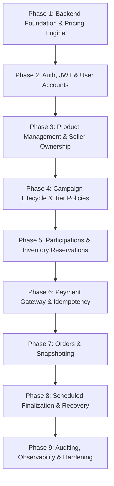

# GroupBuy — Engineering Implementation Roadmap

This document outlines the systematic, phased implementation path for the GroupBuy platform. Each phase builds upon verified previous phases, maintaining high test coverage and architectural integrity.

---

## Phase Status Summary

- **Phase 1 (Completed)**: Production-style backend foundation, Flyway schema (14 tables), configurable pricing engine, REST error handling, OpenAPI/Swagger UI, Docker/Compose, and automated test suite.
- **Phases 2–9 (Planned)**: Outlined below.

---

## Detailed Roadmap

### Phase 2: Authentication, JWT & User Security
- **Goal**: Secure API access with stateless JWTs, role-based authorization, and refresh token rotation.
- **Dependencies**: Phase 1 Security foundation (`SecurityConfig`, `users`, `refresh_tokens`).
- **Key Deliverables**:
  - `User` entity, `UserRepository`, BCrypt password hashing.
  - JWT token generation & validation service (Access token: 15 min; Refresh token: 7 days).
  - Refresh token rotation with cryptographic hash matching and instant revocation on reuse detection.
  - Endpoints: `POST /api/v1/auth/register`, `POST /api/v1/auth/login`, `POST /api/v1/auth/refresh`, `POST /api/v1/auth/logout`.
  - Roles: `CUSTOMER`, `SELLER`, `ADMIN`.

### Phase 3: Product Management & Seller Ownership
- **Goal**: Allow verified sellers to create and maintain product catalogs with stock levels.
- **Dependencies**: Phase 2 User roles (`SELLER`).
- **Key Deliverables**:
  - `Product` entity, `ProductRepository` with optimistic locking (`@Version`).
  - Seller ownership checks: sellers can only edit/archive their own products.
  - Validation: base price $> 0$, inventory counts non-negative.
  - Endpoints: `POST /api/v1/products`, `GET /api/v1/products/{id}`, `PUT /api/v1/products/{id}`.

### Phase 4: Campaign Lifecycle & Configurable Pricing
- **Goal**: Enable sellers to launch group-buying campaigns configured with volume-pricing tiers.
- **Dependencies**: Phase 1 `PricingPolicyValidator`, Phase 3 `Product`.
- **Key Deliverables**:
  - `Campaign` entity, `PricingTier` JPA entities.
  - State machine: `DRAFT` $\rightarrow$ `ACTIVE` $\rightarrow$ `ENDED` $\rightarrow$ `FINALIZING` $\rightarrow$ `FINALIZED` / `CANCELLED`.
  - Strict date validation: `ends_at > starts_at >= now()`.
  - Tier policy persistence utilizing `PricingPolicyValidator`.
  - Endpoints: `POST /api/v1/campaigns`, `GET /api/v1/campaigns/{id}`, `GET /api/v1/campaigns/active`.

### Phase 5: Participations & Concurrency-Safe Inventory Reservations
- **Goal**: Allow customers to reserve units in active campaigns without race conditions or overselling.
- **Dependencies**: Phase 4 Campaigns, Phase 2 Customers.
- **Key Deliverables**:
  - `Participation` and `InventoryReservation` entities.
  - Atomic inventory decrement using database-level locking (`SELECT ... FOR UPDATE` or conditional update `available_inventory - qty >= 0`).
  - 15-minute temporary reservation hold with expiration timestamp.
  - Endpoints: `POST /api/v1/campaigns/{id}/participate`.

### Phase 6: Payment Gateway Abstraction & Idempotent Processing
- **Goal**: Authorize payments reliably using two-phase commit and idempotency headers.
- **Dependencies**: Phase 5 Participations, `idempotency_records`.
- **Key Deliverables**:
  - Payment provider SPI (`PaymentGatewayPort`) with Razorpay/Stripe and mock adapter.
  - Idempotency filter caching responses keyed by `Idempotency-Key` header.
  - Payment attempt history and event logging.
  - Webhook processing with HMAC cryptographic signature validation.

### Phase 7: Order Management & Immutable Price Snapshots
- **Goal**: Create finalized customer orders with settled pricing.
- **Dependencies**: Phase 6 Payments, Phase 4 Campaigns.
- **Key Deliverables**:
  - `Order` entity with immutable unit price snapshot.
  - Order status tracking (`CREATED`, `PAID`, `SHIPPED`, `DELIVERED`).
  - Customer order history query endpoints.

### Phase 8: Scheduled Campaign Finalization & Recovery
- **Goal**: Automatically settle campaigns when their deadline elapses.
- **Dependencies**: All preceding phases.
- **Key Deliverables**:
  - `@Scheduled` job polling for campaigns with `status = 'ACTIVE'` and `ends_at <= now()`.
  - Re-evaluates final paid units against campaign tiers using `PricingService`.
  - Finalizes payments: captures authorized holds or issues differential refunds.
  - Generates orders in a single atomic transaction per campaign.
  - Deadlock prevention and dead-letter failure handling.

### Phase 9: Audit Logging, Observability & Hardening
- **Goal**: Enterprise production readiness.
- **Dependencies**: Full platform.
- **Key Deliverables**:
  - JPA Entity Listeners for automatic `audit_logs` insertion.
  - Structured JSON logging with Correlation IDs (`MDC`).
  - Prometheus metrics via Actuator (`micrometer-registry-prometheus`).
  - Comprehensive end-to-end integration tests.
